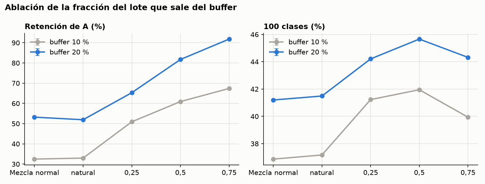
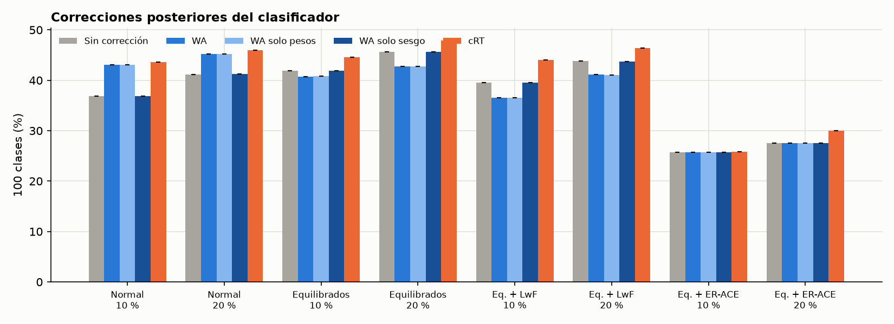
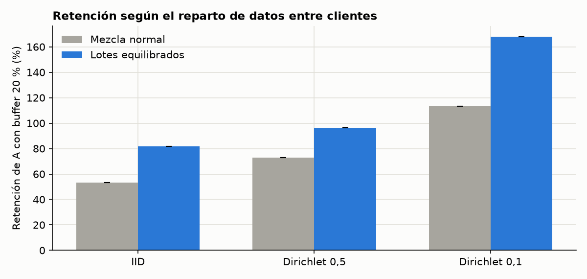

# Informe del plan «plan_kaggle»

Generado el 10/10/2026 02:48. Todos los experimentos de plan_gpu.json, solo con la semilla 42, para comprobar el código en las T4 de Kaggle y comparar con la misma semilla en otra GPU.

Cifras: media ± desviación típica muestral entre semillas; n = número de semillas. Precisión en %.

## Estado

hecha: 16

## 1. Resultados por trabajo

**Mezcla normal** (`principal_normal`)

| Buffer | n | A final | B final | Retención A | 100 clases | 100 cl. con WA | 100 cl. con cRT |
|---|---|---|---|---|---|---|---|
| 0 % | 1 | 0,0 ± 0,0 | 57,3 ± 0,0 | 0,0 ± 0,0 | 28,7 ± 0,0 | 28,7 ± 0,0 | — |
| 5 % | 1 | 9,2 ± 0,0 | 56,4 ± 0,0 | 18,9 ± 0,0 | 32,8 ± 0,0 | 37,5 ± 0,0 | 39,2 ± 0,0 |
| 10 % | 1 | 15,8 ± 0,0 | 58,0 ± 0,0 | 32,5 ± 0,0 | 36,9 ± 0,0 | 43,1 ± 0,0 | 43,6 ± 0,0 |
| 20 % | 1 | 25,9 ± 0,0 | 56,5 ± 0,0 | 53,2 ± 0,0 | 41,2 ± 0,0 | 45,2 ± 0,0 | 46,0 ± 0,0 |

**Lotes equilibrados (0,5)** (`principal_equilibrados`)

| Buffer | n | A final | B final | Retención A | 100 clases | 100 cl. con WA | 100 cl. con cRT |
|---|---|---|---|---|---|---|---|
| 0 % | 1 | 0,0 ± 0,0 | 57,3 ± 0,0 | 0,0 ± 0,0 | 28,7 ± 0,0 | 28,7 ± 0,0 | — |
| 5 % | 1 | 20,1 ± 0,0 | 55,2 ± 0,0 | 41,3 ± 0,0 | 37,7 ± 0,0 | 39,6 ± 0,0 | 41,8 ± 0,0 |
| 10 % | 1 | 29,6 ± 0,0 | 54,3 ± 0,0 | 60,9 ± 0,0 | 42,0 ± 0,0 | 40,8 ± 0,0 | 44,5 ± 0,0 |
| 20 % | 1 | 39,7 ± 0,0 | 51,6 ± 0,0 | 81,7 ± 0,0 | 45,7 ± 0,0 | 42,8 ± 0,0 | 47,9 ± 0,0 |

Referencia conjunta (1 semillas, presupuesto x1): A 44,7 ± 0,0, B 45,2 ± 0,0, 100 clases 45,0 ± 0,0.

**Lotes equilibrados + LwF** (`principal_lwf`)

| Buffer | n | A final | B final | Retención A | 100 clases | 100 cl. con WA | 100 cl. con cRT |
|---|---|---|---|---|---|---|---|
| 0 % | 1 | 0,5 ± 0,0 | 60,3 ± 0,0 | 1,0 ± 0,0 | 30,4 ± 0,0 | 30,4 ± 0,0 | — |
| 5 % | 1 | 12,8 ± 0,0 | 54,4 ± 0,0 | 26,3 ± 0,0 | 33,6 ± 0,0 | 31,8 ± 0,0 | 38,9 ± 0,0 |
| 10 % | 1 | 25,7 ± 0,0 | 53,4 ± 0,0 | 52,9 ± 0,0 | 39,5 ± 0,0 | 36,5 ± 0,0 | 44,0 ± 0,0 |
| 20 % | 1 | 36,5 ± 0,0 | 51,0 ± 0,0 | 75,2 ± 0,0 | 43,8 ± 0,0 | 41,1 ± 0,0 | 46,4 ± 0,0 |

**Equilibrados, fracción natural** (`fraccion_natural`)

| Buffer | n | A final | B final | Retención A | 100 clases | 100 cl. con WA | 100 cl. con cRT |
|---|---|---|---|---|---|---|---|
| 0 % | 1 | 0,0 ± 0,0 | 57,3 ± 0,0 | 0,0 ± 0,0 | 28,7 ± 0,0 | 28,7 ± 0,0 | — |
| 10 % | 1 | 16,0 ± 0,0 | 58,3 ± 0,0 | 33,0 ± 0,0 | 37,2 ± 0,0 | 43,1 ± 0,0 | 43,9 ± 0,0 |
| 20 % | 1 | 25,2 ± 0,0 | 57,7 ± 0,0 | 51,9 ± 0,0 | 41,5 ± 0,0 | 45,3 ± 0,0 | 46,1 ± 0,0 |

**Equilibrados, fracción 0,25** (`fraccion_025`)

| Buffer | n | A final | B final | Retención A | 100 clases | 100 cl. con WA | 100 cl. con cRT |
|---|---|---|---|---|---|---|---|
| 0 % | 1 | 0,0 ± 0,0 | 57,3 ± 0,0 | 0,0 ± 0,0 | 28,7 ± 0,0 | 28,7 ± 0,0 | — |
| 10 % | 1 | 24,7 ± 0,0 | 57,7 ± 0,0 | 50,9 ± 0,0 | 41,2 ± 0,0 | 43,2 ± 0,0 | 45,4 ± 0,0 |
| 20 % | 1 | 31,7 ± 0,0 | 56,7 ± 0,0 | 65,3 ± 0,0 | 44,2 ± 0,0 | 46,0 ± 0,0 | 47,4 ± 0,0 |

**Equilibrados, fracción 0,75** (`fraccion_075`)

| Buffer | n | A final | B final | Retención A | 100 clases | 100 cl. con WA | 100 cl. con cRT |
|---|---|---|---|---|---|---|---|
| 0 % | 1 | 0,0 ± 0,0 | 57,3 ± 0,0 | 0,0 ± 0,0 | 28,7 ± 0,0 | 28,7 ± 0,0 | — |
| 10 % | 1 | 32,8 ± 0,0 | 47,1 ± 0,0 | 67,4 ± 0,0 | 39,9 ± 0,0 | 37,1 ± 0,0 | 42,0 ± 0,0 |
| 20 % | 1 | 44,6 ± 0,0 | 44,0 ± 0,0 | 91,8 ± 0,0 | 44,3 ± 0,0 | 37,6 ± 0,0 | 44,8 ± 0,0 |

**Lotes equilibrados + ER-ACE** (`er_ace`)

| Buffer | n | A final | B final | Retención A | 100 clases | 100 cl. con WA | 100 cl. con cRT |
|---|---|---|---|---|---|---|---|
| 0 % | 1 | 42,5 ± 0,0 | 0,0 ± 0,0 | 87,5 ± 0,0 | 21,3 ± 0,0 | 21,3 ± 0,0 | — |
| 5 % | 1 | 47,0 ± 0,0 | 0,0 ± 0,0 | 96,7 ± 0,0 | 23,5 ± 0,0 | 23,5 ± 0,0 | 24,0 ± 0,0 |
| 10 % | 1 | 51,4 ± 0,0 | 0,0 ± 0,0 | 105,7 ± 0,0 | 25,7 ± 0,0 | 25,7 ± 0,0 | 25,9 ± 0,0 |
| 20 % | 1 | 55,1 ± 0,0 | 0,0 ± 0,0 | 113,3 ± 0,0 | 27,5 ± 0,0 | 27,5 ± 0,0 | 30,0 ± 0,0 |

**Referencia conjunta, presupuesto x2** (`conjunto_2x`)

| Buffer | n | A final | B final | Retención A | 100 clases | 100 cl. con WA | 100 cl. con cRT |
|---|---|---|---|---|---|---|---|
| 0 % | 1 | 0,0 ± 0,0 | 57,3 ± 0,0 | 0,0 ± 0,0 | 28,7 ± 0,0 | 28,7 ± 0,0 | — |

Referencia conjunta (1 semillas, presupuesto x2): A 59,3 ± 0,0, B 60,0 ± 0,0, 100 clases 59,7 ± 0,0.

**Equilibrados, calendario 0,75-0,5-0,25-0,25-0,25** (`calendario`)

| Buffer | n | A final | B final | Retención A | 100 clases | 100 cl. con WA | 100 cl. con cRT |
|---|---|---|---|---|---|---|---|
| 0 % | 1 | 0,0 ± 0,0 | 57,3 ± 0,0 | 0,0 ± 0,0 | 28,7 ± 0,0 | 28,7 ± 0,0 | — |
| 10 % | 1 | 25,3 ± 0,0 | 57,9 ± 0,0 | 52,1 ± 0,0 | 41,6 ± 0,0 | 44,0 ± 0,0 | 45,7 ± 0,0 |
| 20 % | 1 | 34,4 ± 0,0 | 57,8 ± 0,0 | 70,8 ± 0,0 | 46,1 ± 0,0 | 46,9 ± 0,0 | 48,9 ± 0,0 |

**Dirichlet 0,5, mezcla normal** (`dirichlet05_normal`)

| Buffer | n | A final | B final | Retención A | 100 clases | 100 cl. con WA | 100 cl. con cRT |
|---|---|---|---|---|---|---|---|
| 0 % | 1 | 0,0 ± 0,0 | 55,3 ± 0,0 | 0,0 ± 0,0 | 27,7 ± 0,0 | 27,7 ± 0,0 | — |
| 10 % | 1 | 24,4 ± 0,0 | 55,1 ± 0,0 | 55,4 ± 0,0 | 39,8 ± 0,0 | 41,7 ± 0,0 | 43,0 ± 0,0 |
| 20 % | 1 | 32,2 ± 0,0 | 53,0 ± 0,0 | 72,9 ± 0,0 | 42,6 ± 0,0 | 44,2 ± 0,0 | 44,5 ± 0,0 |

**Dirichlet 0,5, lotes equilibrados** (`dirichlet05_equilibrados`)

| Buffer | n | A final | B final | Retención A | 100 clases | 100 cl. con WA | 100 cl. con cRT |
|---|---|---|---|---|---|---|---|
| 0 % | 1 | 0,0 ± 0,0 | 55,3 ± 0,0 | 0,0 ± 0,0 | 27,7 ± 0,0 | 27,7 ± 0,0 | — |
| 10 % | 1 | 35,4 ± 0,0 | 49,5 ± 0,0 | 80,4 ± 0,0 | 42,5 ± 0,0 | 37,2 ± 0,0 | 44,2 ± 0,0 |
| 20 % | 1 | 42,6 ± 0,0 | 46,1 ± 0,0 | 96,6 ± 0,0 | 44,4 ± 0,0 | 38,6 ± 0,0 | 44,8 ± 0,0 |

**Dirichlet 0,1, mezcla normal** (`dirichlet01_normal`)

| Buffer | n | A final | B final | Retención A | 100 clases | 100 cl. con WA | 100 cl. con cRT |
|---|---|---|---|---|---|---|---|
| 0 % | 1 | 0,0 ± 0,0 | 38,5 ± 0,0 | 0,0 ± 0,0 | 19,2 ± 0,0 | 19,2 ± 0,0 | — |
| 10 % | 1 | 18,9 ± 0,0 | 34,5 ± 0,0 | 85,2 ± 0,0 | 26,7 ± 0,0 | 27,2 ± 0,0 | 29,4 ± 0,0 |
| 20 % | 1 | 25,2 ± 0,0 | 33,2 ± 0,0 | 113,4 ± 0,0 | 29,2 ± 0,0 | 29,4 ± 0,0 | 31,2 ± 0,0 |

**Dirichlet 0,1, lotes equilibrados** (`dirichlet01_equilibrados`)

| Buffer | n | A final | B final | Retención A | 100 clases | 100 cl. con WA | 100 cl. con cRT |
|---|---|---|---|---|---|---|---|
| 0 % | 1 | 0,0 ± 0,0 | 38,5 ± 0,0 | 0,0 ± 0,0 | 19,2 ± 0,0 | 19,2 ± 0,0 | — |
| 10 % | 1 | 32,9 ± 0,0 | 28,6 ± 0,0 | 148,0 ± 0,0 | 30,7 ± 0,0 | 29,6 ± 0,0 | 32,3 ± 0,0 |
| 20 % | 1 | 37,3 ± 0,0 | 25,9 ± 0,0 | 168,0 ± 0,0 | 31,6 ± 0,0 | 30,6 ± 0,0 | 33,4 ± 0,0 |

## 2. Ablación de la fracción del lote

¿Pesa más la proporción del buffer en cada lote o el muestreo con reposición? «natural» usa lotes equilibrados con la misma proporción que tendría la mezcla normal: si retiene como la mezcla normal, lo decisivo es la proporción; si retiene como 0,5, es el muestreo.

| Variante | Retención (10 %) | 100 clases (10 %) | Retención (20 %) | 100 clases (20 %) |
|---|---|---|---|---|
| Mezcla normal | 32,5 ± 0,0 | 36,9 ± 0,0 | 53,2 ± 0,0 | 41,2 ± 0,0 |
| natural | 33,0 ± 0,0 | 37,2 ± 0,0 | 51,9 ± 0,0 | 41,5 ± 0,0 |
| 0,25 | 50,9 ± 0,0 | 41,2 ± 0,0 | 65,3 ± 0,0 | 44,2 ± 0,0 |
| 0,5 | 60,9 ± 0,0 | 42,0 ± 0,0 | 81,7 ± 0,0 | 45,7 ± 0,0 |
| 0,75 | 67,4 ± 0,0 | 39,9 ± 0,0 | 91,8 ± 0,0 | 44,3 ± 0,0 |

## 3. Correcciones del clasificador: WA, sus variantes y cRT

Precisión en las 100 clases del mismo modelo final, sin corrección y con cada corrección posterior.

| Variante · buffer | Sin corrección | WA | WA solo pesos | WA solo sesgo | cRT |
|---|---|---|---|---|---|
| Mezcla normal · 5 % | 32,8 ± 0,0 | 37,5 ± 0,0 | 37,5 ± 0,0 | 32,9 ± 0,0 | 39,2 ± 0,0 |
| Mezcla normal · 10 % | 36,9 ± 0,0 | 43,1 ± 0,0 | 43,1 ± 0,0 | 36,9 ± 0,0 | 43,6 ± 0,0 |
| Mezcla normal · 20 % | 41,2 ± 0,0 | 45,2 ± 0,0 | 45,2 ± 0,0 | 41,2 ± 0,0 | 46,0 ± 0,0 |
| Lotes equilibrados (0,5) · 5 % | 37,7 ± 0,0 | 39,6 ± 0,0 | 39,6 ± 0,0 | 37,7 ± 0,0 | 41,8 ± 0,0 |
| Lotes equilibrados (0,5) · 10 % | 42,0 ± 0,0 | 40,8 ± 0,0 | 40,8 ± 0,0 | 41,9 ± 0,0 | 44,5 ± 0,0 |
| Lotes equilibrados (0,5) · 20 % | 45,7 ± 0,0 | 42,8 ± 0,0 | 42,8 ± 0,0 | 45,6 ± 0,0 | 47,9 ± 0,0 |
| Lotes equilibrados + LwF · 5 % | 33,6 ± 0,0 | 31,8 ± 0,0 | 31,8 ± 0,0 | 33,6 ± 0,0 | 38,9 ± 0,0 |
| Lotes equilibrados + LwF · 10 % | 39,5 ± 0,0 | 36,5 ± 0,0 | 36,5 ± 0,0 | 39,5 ± 0,0 | 44,0 ± 0,0 |
| Lotes equilibrados + LwF · 20 % | 43,8 ± 0,0 | 41,1 ± 0,0 | 41,1 ± 0,0 | 43,8 ± 0,0 | 46,4 ± 0,0 |
| Lotes equilibrados + ER-ACE · 5 % | 23,5 ± 0,0 | 23,5 ± 0,0 | 23,5 ± 0,0 | 23,5 ± 0,0 | 24,0 ± 0,0 |
| Lotes equilibrados + ER-ACE · 10 % | 25,7 ± 0,0 | 25,7 ± 0,0 | 25,7 ± 0,0 | 25,7 ± 0,0 | 25,9 ± 0,0 |
| Lotes equilibrados + ER-ACE · 20 % | 27,5 ± 0,0 | 27,5 ± 0,0 | 27,5 ± 0,0 | 27,5 ± 0,0 | 30,0 ± 0,0 |

### Diagnóstico de logits sobre el test de A

Logit media de las clases A y de las B sobre imágenes de A, antes y después de WA. Sirve para contrastar la hipótesis de que WA funciona empujando hacia abajo logits B negativas.

| Variante · buffer | A | B | A con WA | B con WA | γ |
|---|---|---|---|---|---|
| Mezcla normal · 0 % | -42,32 ± 0,00 | -21,94 ± 0,00 | -42,32 ± 0,00 | -33,87 ± 0,00 | 1,54 ± 0,00 |
| Mezcla normal · 5 % | -32,49 ± 0,00 | -26,20 ± 0,00 | -32,49 ± 0,00 | -34,55 ± 0,00 | 1,32 ± 0,00 |
| Mezcla normal · 10 % | -30,33 ± 0,00 | -26,55 ± 0,00 | -30,33 ± 0,00 | -31,01 ± 0,00 | 1,17 ± 0,00 |
| Mezcla normal · 20 % | -28,13 ± 0,00 | -25,95 ± 0,00 | -28,13 ± 0,00 | -28,33 ± 0,00 | 1,09 ± 0,00 |
| Lotes equilibrados (0,5) · 0 % | -42,32 ± 0,00 | -21,94 ± 0,00 | -42,32 ± 0,00 | -33,87 ± 0,00 | 1,54 ± 0,00 |
| Lotes equilibrados (0,5) · 5 % | -31,04 ± 0,00 | -24,08 ± 0,00 | -31,04 ± 0,00 | -33,51 ± 0,00 | 1,39 ± 0,00 |
| Lotes equilibrados (0,5) · 10 % | -29,70 ± 0,00 | -24,30 ± 0,00 | -29,70 ± 0,00 | -32,27 ± 0,00 | 1,33 ± 0,00 |
| Lotes equilibrados (0,5) · 20 % | -27,08 ± 0,00 | -23,64 ± 0,00 | -27,08 ± 0,00 | -29,31 ± 0,00 | 1,24 ± 0,00 |
| Lotes equilibrados + LwF · 0 % | -25,12 ± 0,00 | -20,15 ± 0,00 | -25,12 ± 0,00 | -20,27 ± 0,00 | 1,01 ± 0,00 |
| Lotes equilibrados + LwF · 5 % | -18,98 ± 0,00 | -16,71 ± 0,00 | -18,98 ± 0,00 | -15,12 ± 0,00 | 0,90 ± 0,00 |
| Lotes equilibrados + LwF · 10 % | -17,46 ± 0,00 | -17,24 ± 0,00 | -17,46 ± 0,00 | -15,66 ± 0,00 | 0,91 ± 0,00 |
| Lotes equilibrados + LwF · 20 % | -16,66 ± 0,00 | -17,37 ± 0,00 | -16,66 ± 0,00 | -15,77 ± 0,00 | 0,91 ± 0,00 |
| Lotes equilibrados + ER-ACE · 0 % | -4,63 ± 0,00 | -35,11 ± 0,00 | -4,63 ± 0,00 | -12,88 ± 0,00 | 0,37 ± 0,00 |
| Lotes equilibrados + ER-ACE · 5 % | -20,31 ± 0,00 | -38,71 ± 0,00 | -20,31 ± 0,00 | -30,46 ± 0,00 | 0,79 ± 0,00 |
| Lotes equilibrados + ER-ACE · 10 % | -18,63 ± 0,00 | -39,08 ± 0,00 | -18,63 ± 0,00 | -29,27 ± 0,00 | 0,75 ± 0,00 |
| Lotes equilibrados + ER-ACE · 20 % | -17,12 ± 0,00 | -38,41 ± 0,00 | -17,12 ± 0,00 | -27,50 ± 0,00 | 0,72 ± 0,00 |

## 4. Replay adaptativo en el tiempo

Calendario 0,75-0,5-0,25-0,25-0,25 (media 0,40) frente a fracciones constantes. Si retiene como 0,5 con menos replay medio, el replay concentrado al principio es más eficiente.

| Variante | Retención (10 %) | B (10 %) | 100 cl. (10 %) | Retención (20 %) | B (20 %) | 100 cl. (20 %) |
|---|---|---|---|---|---|---|
| Constante 0,25 | 50,9 ± 0,0 | 57,7 ± 0,0 | 41,2 ± 0,0 | 65,3 ± 0,0 | 56,7 ± 0,0 | 44,2 ± 0,0 |
| Calendario (media 0,40) | 52,1 ± 0,0 | 57,9 ± 0,0 | 41,6 ± 0,0 | 70,8 ± 0,0 | 57,8 ± 0,0 | 46,1 ± 0,0 |
| Constante 0,5 | 60,9 ± 0,0 | 54,3 ± 0,0 | 42,0 ± 0,0 | 81,7 ± 0,0 | 51,6 ± 0,0 | 45,7 ± 0,0 |

## 5. Referencia conjunta según el presupuesto

| Presupuesto | n | A | B | 100 clases |
|---|---|---|---|---|
| x1 | 1 | 44,7 ± 0,0 | 45,2 ± 0,0 | 45,0 ± 0,0 |
| x2 | 1 | 59,3 ± 0,0 | 60,0 ± 0,0 | 59,7 ± 0,0 |

## 6. Datos desiguales entre clientes (Dirichlet)

Menor α = cada cliente tiene menos clases. ¿Siguen ganando los lotes equilibrados cuando los buffers locales están desequilibrados?

| Reparto · variante | 100 cl. (0 %) | Retención (10 %) | 100 cl. (10 %) | Retención (20 %) | 100 cl. (20 %) |
|---|---|---|---|---|---|
| IID · normal | 28,7 ± 0,0 | 32,5 ± 0,0 | 36,9 ± 0,0 | 53,2 ± 0,0 | 41,2 ± 0,0 |
| IID · equilibrados | 28,7 ± 0,0 | 60,9 ± 0,0 | 42,0 ± 0,0 | 81,7 ± 0,0 | 45,7 ± 0,0 |
| Dirichlet 0,5 · normal | 27,7 ± 0,0 | 55,4 ± 0,0 | 39,8 ± 0,0 | 72,9 ± 0,0 | 42,6 ± 0,0 |
| Dirichlet 0,5 · equilibrados | 27,7 ± 0,0 | 80,4 ± 0,0 | 42,5 ± 0,0 | 96,6 ± 0,0 | 44,4 ± 0,0 |
| Dirichlet 0,1 · normal | 19,2 ± 0,0 | 85,2 ± 0,0 | 26,7 ± 0,0 | 113,4 ± 0,0 | 29,2 ± 0,0 |
| Dirichlet 0,1 · equilibrados | 19,2 ± 0,0 | 148,0 ± 0,0 | 30,7 ± 0,0 | 168,0 ± 0,0 | 31,6 ± 0,0 |

