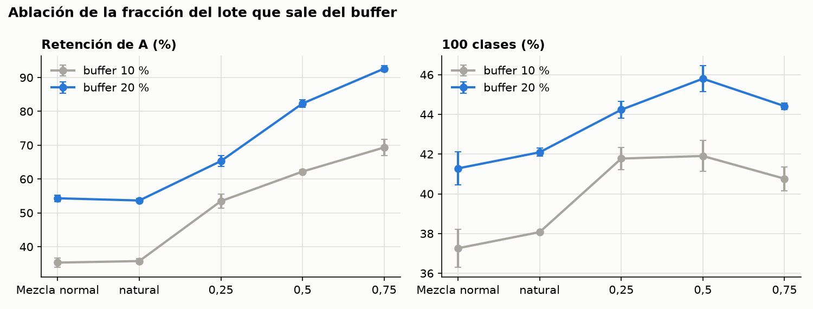
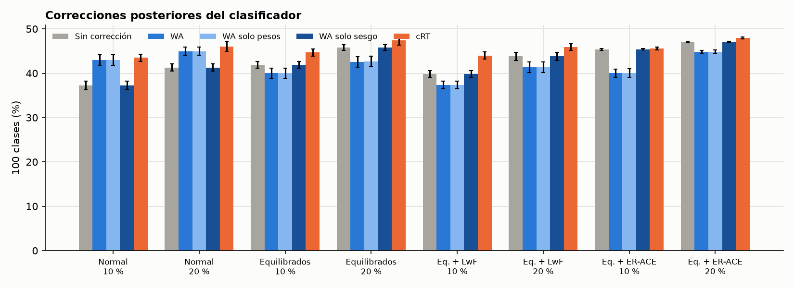
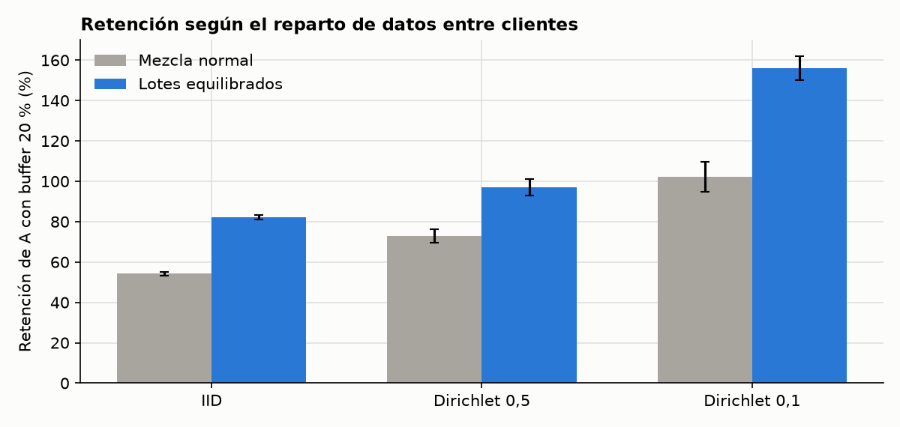

# Informe del plan «plan_gpu»

Generado el 13/10/2026 20:52. Experimentos para cerrar el estudio de replay (bloque 1) y extenderlo a datos no IID y replay adaptativo. Orden = prioridad.

Cifras: media ± desviación típica muestral entre semillas; n = número de semillas. Precisión en %.

## Estado

hecha: 56

## 1. Resultados por trabajo

**Mezcla normal** (`principal_normal`)

| Buffer | n | A final | B final | Retención A | 100 clases | 100 cl. con WA | 100 cl. con cRT |
|---|---|---|---|---|---|---|---|
| 0 % | 5 | 0,0 ± 0,0 | 57,5 ± 1,4 | 0,0 ± 0,0 | 28,8 ± 0,7 | 28,8 ± 0,7 | — |
| 5 % | 5 | 9,1 ± 1,1 | 57,1 ± 1,3 | 19,0 ± 2,3 | 33,1 ± 1,1 | 37,7 ± 1,9 | 39,5 ± 1,4 |
| 10 % | 5 | 17,0 ± 0,8 | 57,6 ± 1,3 | 35,3 ± 1,3 | 37,3 ± 1,0 | 43,0 ± 1,2 | 43,5 ± 0,8 |
| 20 % | 5 | 26,1 ± 0,7 | 56,5 ± 1,1 | 54,3 ± 0,9 | 41,3 ± 0,8 | 45,0 ± 0,9 | 46,1 ± 1,1 |

**Lotes equilibrados (0,5)** (`principal_equilibrados`)

| Buffer | n | A final | B final | Retención A | 100 clases | 100 cl. con WA | 100 cl. con cRT |
|---|---|---|---|---|---|---|---|
| 0 % | 5 | 0,0 ± 0,0 | 57,5 ± 1,4 | 0,0 ± 0,0 | 28,8 ± 0,7 | 28,8 ± 0,7 | — |
| 5 % | 5 | 20,4 ± 0,6 | 55,3 ± 1,2 | 42,5 ± 1,3 | 37,8 ± 0,8 | 39,0 ± 1,2 | 41,9 ± 0,7 |
| 10 % | 5 | 29,9 ± 0,4 | 53,9 ± 1,1 | 62,2 ± 0,5 | 41,9 ± 0,8 | 40,0 ± 1,1 | 44,7 ± 0,8 |
| 20 % | 5 | 39,5 ± 0,3 | 52,1 ± 1,0 | 82,3 ± 1,1 | 45,8 ± 0,7 | 42,6 ± 1,2 | 47,4 ± 1,0 |

Referencia conjunta (5 semillas, presupuesto x1): A 44,9 ± 0,4, B 46,2 ± 1,1, 100 clases 45,6 ± 0,7.

**Lotes equilibrados + LwF** (`principal_lwf`)

| Buffer | n | A final | B final | Retención A | 100 clases | 100 cl. con WA | 100 cl. con cRT |
|---|---|---|---|---|---|---|---|
| 0 % | 5 | 0,3 ± 0,1 | 59,9 ± 1,2 | 0,5 ± 0,2 | 30,1 ± 0,6 | 30,1 ± 0,6 | — |
| 5 % | 5 | 14,6 ± 0,9 | 54,3 ± 1,0 | 30,5 ± 2,3 | 34,5 ± 0,6 | 32,5 ± 0,6 | 39,6 ± 0,8 |
| 10 % | 5 | 26,6 ± 0,6 | 53,1 ± 1,0 | 55,4 ± 0,9 | 39,8 ± 0,7 | 37,4 ± 0,9 | 44,0 ± 0,8 |
| 20 % | 5 | 36,8 ± 1,1 | 50,9 ± 0,9 | 76,6 ± 0,8 | 43,8 ± 0,9 | 41,4 ± 1,2 | 45,9 ± 0,8 |

**Equilibrados, fracción natural** (`fraccion_natural`)

| Buffer | n | A final | B final | Retención A | 100 clases | 100 cl. con WA | 100 cl. con cRT |
|---|---|---|---|---|---|---|---|
| 0 % | 3 | 0,0 ± 0,0 | 58,5 ± 0,2 | 0,0 ± 0,0 | 29,2 ± 0,1 | 29,2 ± 0,1 | — |
| 10 % | 3 | 17,4 ± 0,3 | 58,7 ± 0,3 | 35,8 ± 0,7 | 38,1 ± 0,1 | 43,5 ± 0,4 | 44,6 ± 0,3 |
| 20 % | 3 | 26,1 ± 0,3 | 58,1 ± 0,1 | 53,7 ± 0,6 | 42,1 ± 0,2 | 46,1 ± 0,3 | 47,1 ± 0,5 |

**Equilibrados, fracción 0,25** (`fraccion_025`)

| Buffer | n | A final | B final | Retención A | 100 clases | 100 cl. con WA | 100 cl. con cRT |
|---|---|---|---|---|---|---|---|
| 0 % | 3 | 0,0 ± 0,0 | 58,5 ± 0,2 | 0,0 ± 0,0 | 29,2 ± 0,1 | 29,2 ± 0,1 | — |
| 10 % | 3 | 26,0 ± 1,0 | 57,5 ± 0,2 | 53,5 ± 2,0 | 41,8 ± 0,6 | 43,1 ± 1,0 | 45,8 ± 0,1 |
| 20 % | 3 | 31,8 ± 0,8 | 56,7 ± 0,2 | 65,3 ± 1,6 | 44,2 ± 0,4 | 46,4 ± 0,3 | 47,6 ± 0,3 |

**Equilibrados, fracción 0,75** (`fraccion_075`)

| Buffer | n | A final | B final | Retención A | 100 clases | 100 cl. con WA | 100 cl. con cRT |
|---|---|---|---|---|---|---|---|
| 0 % | 3 | 0,0 ± 0,0 | 58,5 ± 0,2 | 0,0 ± 0,0 | 29,2 ± 0,1 | 29,2 ± 0,1 | — |
| 10 % | 3 | 33,8 ± 1,1 | 47,8 ± 0,4 | 69,3 ± 2,4 | 40,8 ± 0,6 | 37,0 ± 0,4 | 42,1 ± 0,3 |
| 20 % | 3 | 45,1 ± 0,3 | 43,7 ± 0,1 | 92,6 ± 0,9 | 44,4 ± 0,2 | 37,7 ± 0,2 | 45,4 ± 0,2 |

**Lotes equilibrados + ER-ACE** (`er_ace`)

| Buffer | n | A final | B final | Retención A | 100 clases | 100 cl. con WA | 100 cl. con cRT |
|---|---|---|---|---|---|---|---|
| 0 % | 3 | 0,0 ± 0,0 | 58,5 ± 0,2 | 0,0 ± 0,0 | 29,2 ± 0,1 | 29,2 ± 0,1 | — |
| 5 % | 3 | 35,6 ± 0,4 | 50,4 ± 0,7 | 73,1 ± 1,1 | 43,0 ± 0,4 | 36,0 ± 0,4 | 43,3 ± 0,1 |
| 10 % | 3 | 40,4 ± 0,4 | 50,4 ± 0,1 | 83,0 ± 1,1 | 45,4 ± 0,2 | 40,0 ± 0,9 | 45,6 ± 0,3 |
| 20 % | 3 | 44,1 ± 0,3 | 50,0 ± 0,4 | 90,5 ± 0,4 | 47,1 ± 0,1 | 44,8 ± 0,3 | 47,9 ± 0,2 |

**Referencia conjunta, presupuesto x2** (`conjunto_2x`)

| Buffer | n | A final | B final | Retención A | 100 clases | 100 cl. con WA | 100 cl. con cRT |
|---|---|---|---|---|---|---|---|
| 0 % | 3 | 0,0 ± 0,0 | 58,5 ± 0,2 | 0,0 ± 0,0 | 29,2 ± 0,1 | 29,2 ± 0,1 | — |

Referencia conjunta (3 semillas, presupuesto x2): A 59,2 ± 0,6, B 61,1 ± 0,7, 100 clases 60,1 ± 0,6.

**Equilibrados, calendario 0,75-0,5-0,25-0,25-0,25** (`calendario`)

| Buffer | n | A final | B final | Retención A | 100 clases | 100 cl. con WA | 100 cl. con cRT |
|---|---|---|---|---|---|---|---|
| 0 % | 3 | 0,0 ± 0,0 | 58,5 ± 0,2 | 0,0 ± 0,0 | 29,2 ± 0,1 | 29,2 ± 0,1 | — |
| 10 % | 3 | 26,5 ± 0,3 | 58,0 ± 0,7 | 54,5 ± 0,5 | 42,3 ± 0,3 | 44,5 ± 0,7 | 46,5 ± 0,3 |
| 20 % | 3 | 34,1 ± 0,4 | 57,2 ± 0,1 | 70,1 ± 1,0 | 45,7 ± 0,2 | 47,3 ± 0,4 | 49,2 ± 0,3 |

**Dirichlet 0,5, mezcla normal** (`dirichlet05_normal`)

| Buffer | n | A final | B final | Retención A | 100 clases | 100 cl. con WA | 100 cl. con cRT |
|---|---|---|---|---|---|---|---|
| 0 % | 3 | 0,0 ± 0,0 | 55,8 ± 2,0 | 0,0 ± 0,0 | 27,9 ± 1,0 | 27,9 ± 1,0 | — |
| 10 % | 3 | 23,4 ± 0,4 | 55,4 ± 1,3 | 52,6 ± 1,5 | 39,4 ± 0,5 | 42,5 ± 1,0 | 43,4 ± 1,0 |
| 20 % | 3 | 32,4 ± 1,1 | 54,0 ± 1,7 | 72,8 ± 3,3 | 43,2 ± 0,4 | 44,7 ± 0,9 | 45,4 ± 0,9 |

**Dirichlet 0,5, lotes equilibrados** (`dirichlet05_equilibrados`)

| Buffer | n | A final | B final | Retención A | 100 clases | 100 cl. con WA | 100 cl. con cRT |
|---|---|---|---|---|---|---|---|
| 0 % | 3 | 0,0 ± 0,0 | 55,8 ± 2,0 | 0,0 ± 0,0 | 27,9 ± 1,0 | 27,9 ± 1,0 | — |
| 10 % | 3 | 35,2 ± 0,5 | 50,0 ± 1,7 | 79,1 ± 2,1 | 42,6 ± 0,7 | 37,0 ± 1,4 | 44,1 ± 0,7 |
| 20 % | 3 | 43,1 ± 1,3 | 47,7 ± 2,2 | 97,0 ± 4,0 | 45,4 ± 0,9 | 39,7 ± 1,2 | 45,9 ± 0,7 |

**Dirichlet 0,1, mezcla normal** (`dirichlet01_normal`)

| Buffer | n | A final | B final | Retención A | 100 clases | 100 cl. con WA | 100 cl. con cRT |
|---|---|---|---|---|---|---|---|
| 0 % | 3 | 0,0 ± 0,0 | 38,8 ± 1,9 | 0,0 ± 0,0 | 19,4 ± 0,9 | 19,4 ± 0,9 | — |
| 10 % | 3 | 17,2 ± 1,5 | 36,2 ± 2,7 | 75,2 ± 8,7 | 26,7 ± 0,7 | 28,2 ± 1,0 | 30,3 ± 1,3 |
| 20 % | 3 | 23,5 ± 1,1 | 35,3 ± 1,8 | 102,2 ± 7,4 | 29,4 ± 0,4 | 29,8 ± 0,4 | 32,0 ± 0,8 |

**Dirichlet 0,1, lotes equilibrados** (`dirichlet01_equilibrados`)

| Buffer | n | A final | B final | Retención A | 100 clases | 100 cl. con WA | 100 cl. con cRT |
|---|---|---|---|---|---|---|---|
| 0 % | 3 | 0,0 ± 0,0 | 38,8 ± 1,9 | 0,0 ± 0,0 | 19,4 ± 0,9 | 19,4 ± 0,9 | — |
| 10 % | 3 | 32,0 ± 1,4 | 30,4 ± 1,9 | 139,5 ± 9,4 | 31,2 ± 0,4 | 30,3 ± 1,1 | 33,3 ± 1,0 |
| 20 % | 3 | 35,9 ± 0,7 | 28,3 ± 2,9 | 156,1 ± 5,9 | 32,1 ± 1,2 | 30,9 ± 1,3 | 33,9 ± 1,1 |

## 2. Ablación de la fracción del lote

¿Pesa más la proporción del buffer en cada lote o el muestreo con reposición? «natural» usa lotes equilibrados con la misma proporción que tendría la mezcla normal: si retiene como la mezcla normal, lo decisivo es la proporción; si retiene como 0,5, es el muestreo.

| Variante | Retención (10 %) | 100 clases (10 %) | Retención (20 %) | 100 clases (20 %) |
|---|---|---|---|---|
| Mezcla normal | 35,3 ± 1,3 | 37,3 ± 1,0 | 54,3 ± 0,9 | 41,3 ± 0,8 |
| natural | 35,8 ± 0,7 | 38,1 ± 0,1 | 53,7 ± 0,6 | 42,1 ± 0,2 |
| 0,25 | 53,5 ± 2,0 | 41,8 ± 0,6 | 65,3 ± 1,6 | 44,2 ± 0,4 |
| 0,5 | 62,2 ± 0,5 | 41,9 ± 0,8 | 82,3 ± 1,1 | 45,8 ± 0,7 |
| 0,75 | 69,3 ± 2,4 | 40,8 ± 0,6 | 92,6 ± 0,9 | 44,4 ± 0,2 |

## 3. Correcciones del clasificador: WA, sus variantes y cRT

Precisión en las 100 clases del mismo modelo final, sin corrección y con cada corrección posterior.

| Variante · buffer | Sin corrección | WA | WA solo pesos | WA solo sesgo | cRT |
|---|---|---|---|---|---|
| Mezcla normal · 5 % | 33,1 ± 1,1 | 37,7 ± 1,9 | 37,7 ± 1,9 | 33,1 ± 1,1 | 39,5 ± 1,4 |
| Mezcla normal · 10 % | 37,3 ± 1,0 | 43,0 ± 1,2 | 43,0 ± 1,2 | 37,3 ± 1,0 | 43,5 ± 0,8 |
| Mezcla normal · 20 % | 41,3 ± 0,8 | 45,0 ± 0,9 | 45,0 ± 0,9 | 41,3 ± 0,8 | 46,1 ± 1,1 |
| Lotes equilibrados (0,5) · 5 % | 37,8 ± 0,8 | 39,0 ± 1,2 | 39,0 ± 1,2 | 37,9 ± 0,8 | 41,9 ± 0,7 |
| Lotes equilibrados (0,5) · 10 % | 41,9 ± 0,8 | 40,0 ± 1,1 | 40,0 ± 1,1 | 41,9 ± 0,8 | 44,7 ± 0,8 |
| Lotes equilibrados (0,5) · 20 % | 45,8 ± 0,7 | 42,6 ± 1,2 | 42,6 ± 1,2 | 45,8 ± 0,7 | 47,4 ± 1,0 |
| Lotes equilibrados + LwF · 5 % | 34,5 ± 0,6 | 32,5 ± 0,6 | 32,5 ± 0,6 | 34,5 ± 0,6 | 39,6 ± 0,8 |
| Lotes equilibrados + LwF · 10 % | 39,8 ± 0,7 | 37,4 ± 0,9 | 37,4 ± 0,9 | 39,9 ± 0,7 | 44,0 ± 0,8 |
| Lotes equilibrados + LwF · 20 % | 43,8 ± 0,9 | 41,4 ± 1,2 | 41,4 ± 1,2 | 43,8 ± 0,9 | 45,9 ± 0,8 |
| Lotes equilibrados + ER-ACE · 5 % | 43,0 ± 0,4 | 36,0 ± 0,4 | 36,0 ± 0,4 | 43,0 ± 0,4 | 43,3 ± 0,1 |
| Lotes equilibrados + ER-ACE · 10 % | 45,4 ± 0,2 | 40,0 ± 0,9 | 40,1 ± 0,9 | 45,4 ± 0,2 | 45,6 ± 0,3 |
| Lotes equilibrados + ER-ACE · 20 % | 47,1 ± 0,1 | 44,8 ± 0,3 | 44,9 ± 0,3 | 47,1 ± 0,1 | 47,9 ± 0,2 |

### Diagnóstico de logits sobre el test de A

Logit media de las clases A y de las B sobre imágenes de A, antes y después de WA. Sirve para contrastar la hipótesis de que WA funciona empujando hacia abajo logits B negativas.

| Variante · buffer | A | B | A con WA | B con WA | γ |
|---|---|---|---|---|---|
| Mezcla normal · 0 % | -43,76 ± 1,19 | -23,19 ± 0,99 | -43,76 ± 1,19 | -35,68 ± 1,36 | 1,54 ± 0,01 |
| Mezcla normal · 5 % | -32,74 ± 1,68 | -26,60 ± 1,66 | -32,74 ± 1,68 | -34,87 ± 1,49 | 1,31 ± 0,03 |
| Mezcla normal · 10 % | -31,17 ± 1,57 | -27,44 ± 1,58 | -31,17 ± 1,57 | -32,07 ± 1,53 | 1,17 ± 0,01 |
| Mezcla normal · 20 % | -28,72 ± 1,25 | -26,55 ± 1,29 | -28,72 ± 1,25 | -29,06 ± 1,22 | 1,09 ± 0,01 |
| Lotes equilibrados (0,5) · 0 % | -43,76 ± 1,19 | -23,19 ± 0,99 | -43,76 ± 1,19 | -35,68 ± 1,36 | 1,54 ± 0,01 |
| Lotes equilibrados (0,5) · 5 % | -31,11 ± 0,40 | -24,27 ± 0,43 | -31,11 ± 0,40 | -33,57 ± 0,52 | 1,38 ± 0,01 |
| Lotes equilibrados (0,5) · 10 % | -29,90 ± 0,47 | -24,60 ± 0,40 | -29,90 ± 0,47 | -32,62 ± 0,50 | 1,33 ± 0,01 |
| Lotes equilibrados (0,5) · 20 % | -27,39 ± 0,53 | -24,01 ± 0,53 | -27,39 ± 0,53 | -29,66 ± 0,55 | 1,24 ± 0,01 |
| Lotes equilibrados + LwF · 0 % | -25,49 ± 0,46 | -20,49 ± 0,44 | -25,49 ± 0,46 | -20,69 ± 0,46 | 1,01 ± 0,00 |
| Lotes equilibrados + LwF · 5 % | -18,80 ± 0,33 | -16,98 ± 0,23 | -18,80 ± 0,33 | -15,41 ± 0,37 | 0,91 ± 0,01 |
| Lotes equilibrados + LwF · 10 % | -17,44 ± 0,26 | -17,39 ± 0,22 | -17,44 ± 0,26 | -15,88 ± 0,33 | 0,91 ± 0,01 |
| Lotes equilibrados + LwF · 20 % | -16,66 ± 0,26 | -17,43 ± 0,25 | -16,66 ± 0,26 | -15,89 ± 0,32 | 0,91 ± 0,01 |
| Lotes equilibrados + ER-ACE · 0 % | -43,09 ± 0,80 | -22,68 ± 0,54 | -43,09 ± 0,80 | -34,90 ± 0,81 | 1,54 ± 0,00 |
| Lotes equilibrados + ER-ACE · 5 % | -33,54 ± 0,57 | -30,04 ± 0,48 | -33,54 ± 0,57 | -36,45 ± 0,56 | 1,21 ± 0,00 |
| Lotes equilibrados + ER-ACE · 10 % | -32,75 ± 0,52 | -30,38 ± 0,45 | -32,75 ± 0,52 | -35,20 ± 0,53 | 1,16 ± 0,00 |
| Lotes equilibrados + ER-ACE · 20 % | -29,34 ± 0,27 | -28,42 ± 0,21 | -29,34 ± 0,27 | -30,79 ± 0,19 | 1,08 ± 0,00 |

## 4. Replay adaptativo en el tiempo

Calendario 0,75-0,5-0,25-0,25-0,25 (media 0,40) frente a fracciones constantes. Si retiene como 0,5 con menos replay medio, el replay concentrado al principio es más eficiente.

| Variante | Retención (10 %) | B (10 %) | 100 cl. (10 %) | Retención (20 %) | B (20 %) | 100 cl. (20 %) |
|---|---|---|---|---|---|---|
| Constante 0,25 | 53,5 ± 2,0 | 57,5 ± 0,2 | 41,8 ± 0,6 | 65,3 ± 1,6 | 56,7 ± 0,2 | 44,2 ± 0,4 |
| Calendario (media 0,40) | 54,5 ± 0,5 | 58,0 ± 0,7 | 42,3 ± 0,3 | 70,1 ± 1,0 | 57,2 ± 0,1 | 45,7 ± 0,2 |
| Constante 0,5 | 62,2 ± 0,5 | 53,9 ± 1,1 | 41,9 ± 0,8 | 82,3 ± 1,1 | 52,1 ± 1,0 | 45,8 ± 0,7 |

## 5. Referencia conjunta según el presupuesto

| Presupuesto | n | A | B | 100 clases |
|---|---|---|---|---|
| x1 | 5 | 44,9 ± 0,4 | 46,2 ± 1,1 | 45,6 ± 0,7 |
| x2 | 3 | 59,2 ± 0,6 | 61,1 ± 0,7 | 60,1 ± 0,6 |

## 6. Datos desiguales entre clientes (Dirichlet)

Menor α = cada cliente tiene menos clases. ¿Siguen ganando los lotes equilibrados cuando los buffers locales están desequilibrados? Con α pequeño la fase 1 queda débil y A puede seguir mejorando en la fase 2, así que la retención puede pasar del 100 %: aquí conviene comparar las precisiones absolutas (100 clases).

| Reparto · variante | 100 cl. (0 %) | Retención (10 %) | 100 cl. (10 %) | Retención (20 %) | 100 cl. (20 %) |
|---|---|---|---|---|---|
| IID · normal | 28,8 ± 0,7 | 35,3 ± 1,3 | 37,3 ± 1,0 | 54,3 ± 0,9 | 41,3 ± 0,8 |
| IID · equilibrados | 28,8 ± 0,7 | 62,2 ± 0,5 | 41,9 ± 0,8 | 82,3 ± 1,1 | 45,8 ± 0,7 |
| Dirichlet 0,5 · normal | 27,9 ± 1,0 | 52,6 ± 1,5 | 39,4 ± 0,5 | 72,8 ± 3,3 | 43,2 ± 0,4 |
| Dirichlet 0,5 · equilibrados | 27,9 ± 1,0 | 79,1 ± 2,1 | 42,6 ± 0,7 | 97,0 ± 4,0 | 45,4 ± 0,9 |
| Dirichlet 0,1 · normal | 19,4 ± 0,9 | 75,2 ± 8,7 | 26,7 ± 0,7 | 102,2 ± 7,4 | 29,4 ± 0,4 |
| Dirichlet 0,1 · equilibrados | 19,4 ± 0,9 | 139,5 ± 9,4 | 31,2 ± 0,4 | 156,1 ± 5,9 | 32,1 ± 1,2 |

